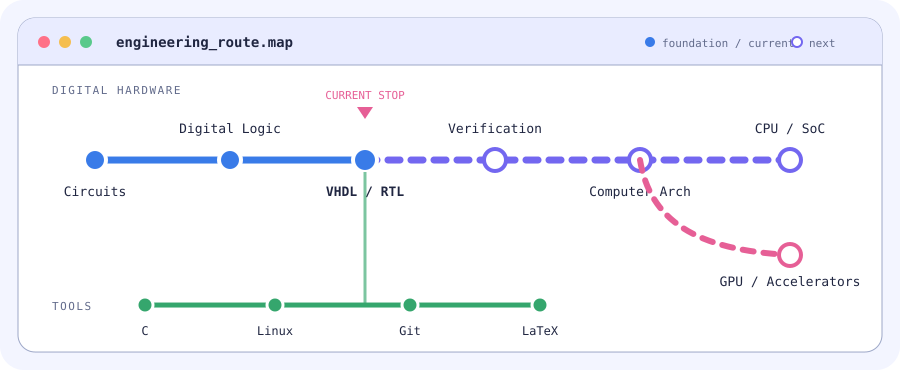

<picture>
  <source media="(prefers-color-scheme: dark)" srcset="./assets/profile-dark.svg">
  <source media="(prefers-color-scheme: light)" srcset="./assets/profile-light.svg">
  
</picture>

### Hardware engineer in progress

`Digital Design` · `Computer Architecture` · `CPU / GPU / SoC` · `Verification`

Maintaining course notes. Building toward a complete RTL project.

### Engineering route map

<picture>
  <source media="(prefers-color-scheme: dark)" srcset="./assets/route-dark.svg">
  <source media="(prefers-color-scheme: light)" srcset="./assets/route-light.svg">
  
</picture>
