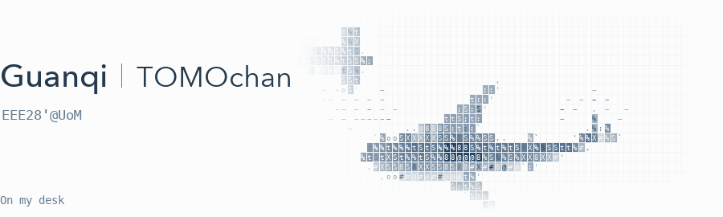

<picture>
  <source media="(prefers-color-scheme: dark)" srcset="./assets/shark-header-dark.gif">
  <source media="(prefers-color-scheme: light)" srcset="./assets/shark-header-light.gif">
  
</picture>

🎮 **[Mai Pattern Lab](https://github.com/ZGQmoe/maimai-pattern-lab-public)**  
📓 **[Course notes](https://github.com/ZGQmoe?tab=repositories&q=Notes)**
