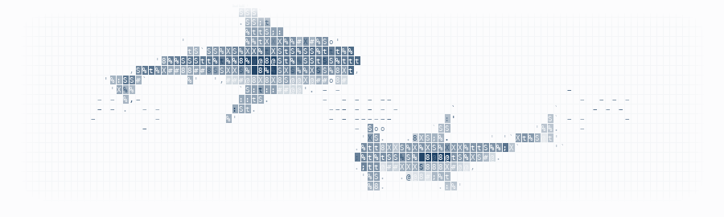

### <samp>Guanqi｜TOMOchan</samp>

<samp>EEE28'@UoM</samp>

<picture>
  <source media="(prefers-color-scheme: dark)" srcset="./assets/shark-ocean-dark.gif">
  <source media="(prefers-color-scheme: light)" srcset="./assets/shark-ocean-light.gif">
  
</picture>

**<samp>On my desk</samp>**

🎮 **[Mai Pattern Lab](https://github.com/ZGQmoe/maimai-pattern-lab-public)**  
📓 **[Course notes](https://github.com/ZGQmoe?tab=repositories&q=Notes)**

<table>
  <tr>
    <td align="center" width="135">
      📘  
      <a href="https://github.com/ZGQmoe/EEEN-11102-Notes"><strong>Digital logic</strong></a>  
      <samp>EEEN11102</samp>
    </td>
    <td align="center" width="135">
      📕  
      <a href="https://github.com/ZGQmoe/EEEN-11302-Notes"><strong>Semi- conductors</strong></a>  
      <samp>EEEN11302</samp>
    </td>
    <td align="center" width="135">
      📗  
      <a href="https://github.com/ZGQmoe/MATHS-19622-Notes"><strong>Multivariate calculus</strong></a>  
      <samp>MATHS19622</samp>
    </td>
    <td align="center" width="135">
      📙  
      <a href="https://github.com/ZGQmoe/EEEN-20131-Notes"><strong>Signals &amp; systems</strong></a>  
      <samp>EEEN20131</samp>
    </td>
  </tr>
</table>
