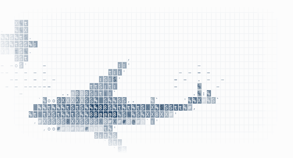

<picture>
  <source media="(prefers-color-scheme: dark)" srcset="./assets/shark-float-dark.gif">
  <source media="(prefers-color-scheme: light)" srcset="./assets/shark-float-light.gif">
  
</picture>

  

### <samp>Guanqi｜TOMOchan</samp>

<samp>EEE28'@UoM</samp>

  

**<samp>On my desk</samp>**

🎮 **[Mai Pattern Lab](https://github.com/ZGQmoe/maimai-pattern-lab-public)**  
📓 **[Course notes](https://github.com/ZGQmoe?tab=repositories&q=Notes)**

 
